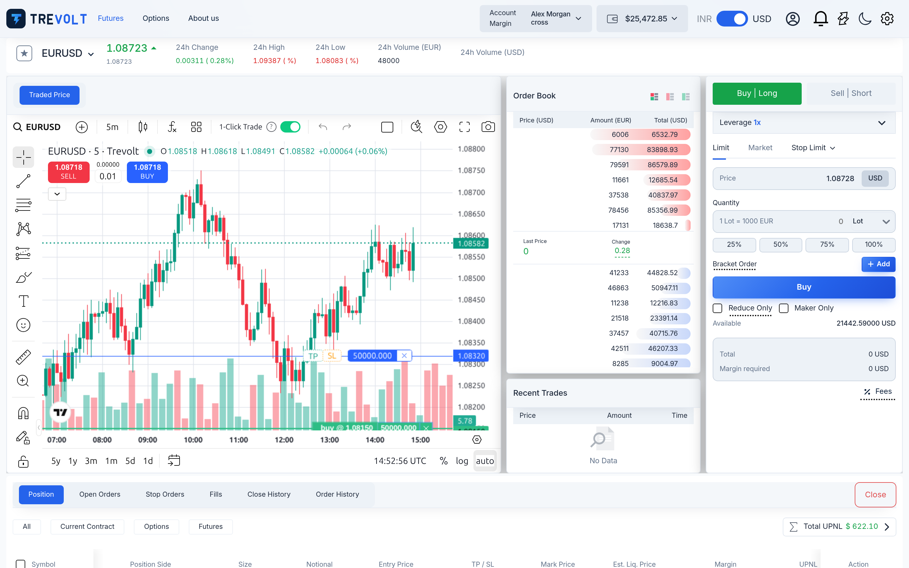
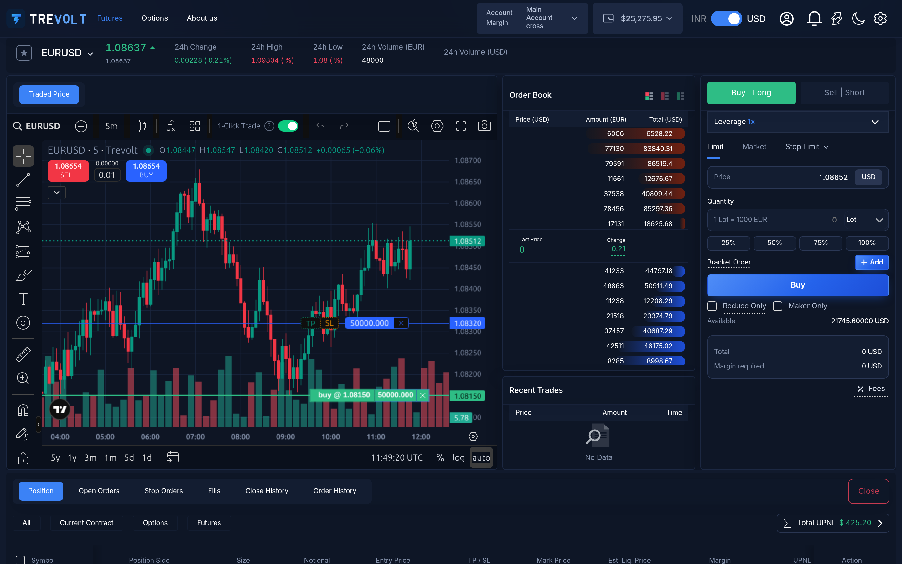
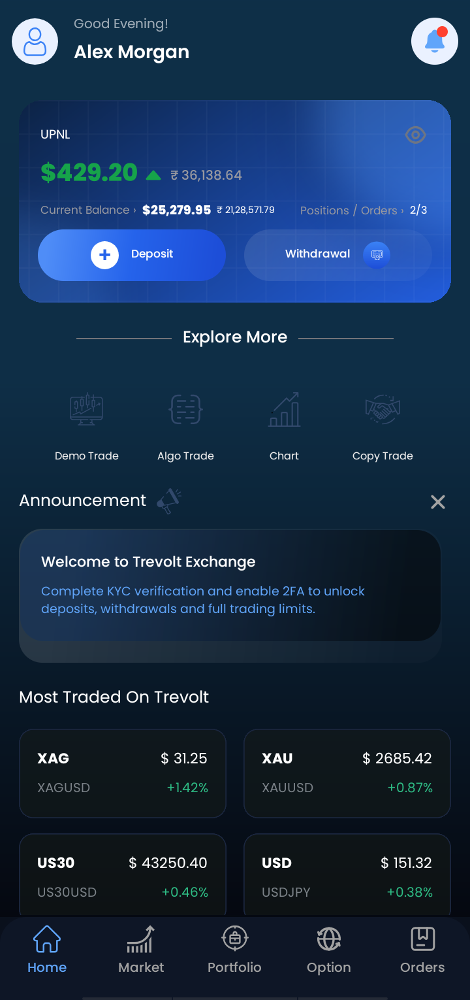
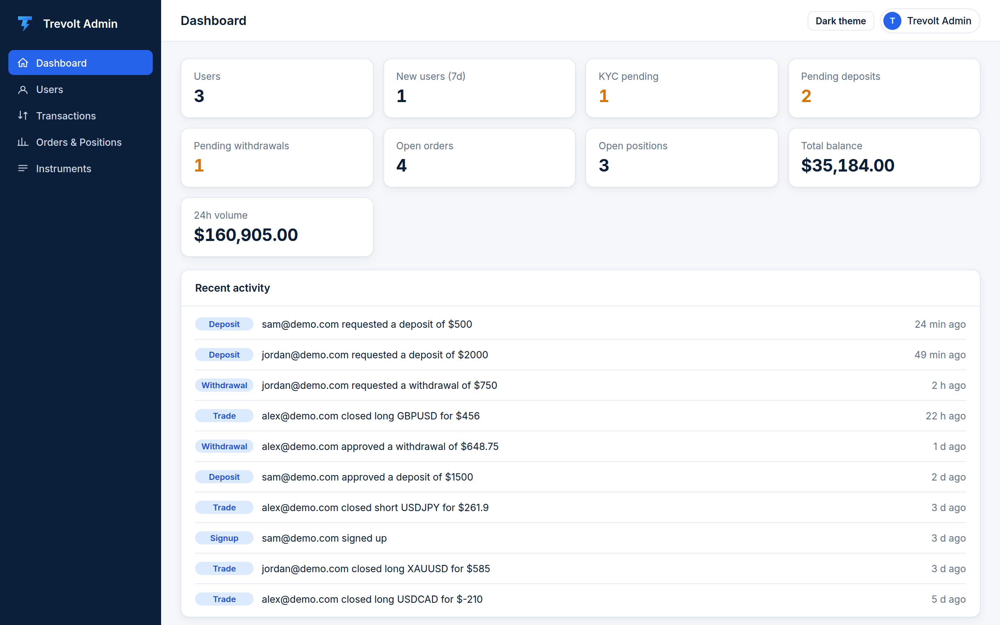
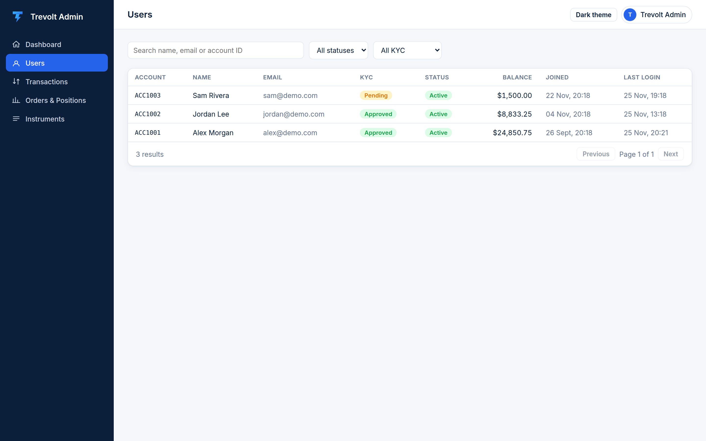
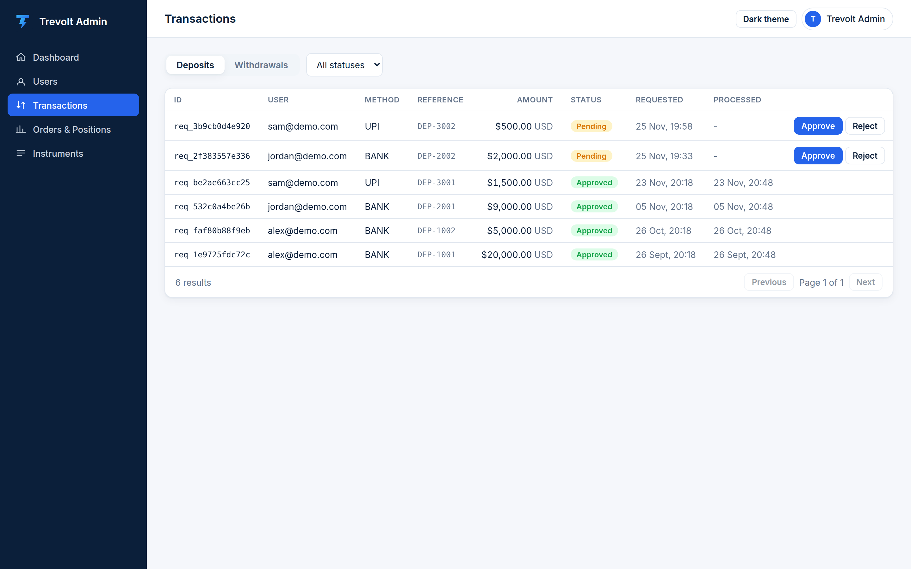

# Trevolt

A full stack forex and CFD trading demo. It has a React web app, a React Native mobile app, a Node backend with a SQLite database, and an admin panel. You can sign up, log in, place market and limit orders against a live simulated price feed, watch positions and P&L change, and request deposits and withdrawals that an admin approves.

The prices are simulated and the money is not real. Nothing here connects to a broker or a payment provider.



| Web, dark | Mobile, light | Mobile, dark |
|---|---|---|
|  |  |  |

## Admin panel



| Users and KYC | Deposits and withdrawals |
|---|---|
|  |  |

Admins can approve KYC, block users, adjust balances, approve or reject deposits and withdrawals, watch orders and open positions, and change an instrument's spread, leverage and status.

## What works for real

These are backed by the database in `api/`:

- Sign up, log in, log out, blocked users
- Wallet balance, deposit and withdrawal requests, transaction history
- Market, limit, stop and stop-limit orders, cancel, close position, take profit and stop loss, change leverage
- Margin checks, commission per lot, P&L, and a stop-out when equity falls too low
- Order, fill, position and closed-trade history, pushed to the apps over sockets
- Every admin action listed above

The blog, learn section, options chain, copy trading and a few other pages are still static demo content served by the same API.

## Layout

| Folder | What it is |
|---|---|
| `web/` | React 19, Vite, Redux Toolkit, React Router, Axios, socket.io-client |
| `mobile/` | React Native 0.81 with TypeScript, Redux Toolkit, MMKV |
| `api/` | Node, Express, Socket.IO and the built-in `node:sqlite` |
| `admin/` | React and Vite admin panel |
| `docs/` | The admin API contract and screenshots |

The clients send and receive AES-encrypted JSON, so the API does the same. The default key is `demo`. The admin panel talks plain JSON.

## Running it

You need Node 22.5 or newer (the API uses `node:sqlite`).

Start the API. The first start creates `api/data/trevolt.db` and seeds it. The demo and admin logins are listed in `api/README.md`.

```
cd api
npm install
npm start
```

Web app:

```
cd web
cp .env.example .env.dev
npm install
npm run dev
```

Admin panel:

```
cd admin
npm install
npm run dev
```

The admin panel runs on port 5174 and the web app on 5173. The reCAPTCHA checkbox on the web login and signup forms is switched off in this demo build.

The chart on the terminal uses the TradingView Charting Library. It is licensed, so it is not in this repo. If you have access to it, copy `charting_library` and `datafeeds` into `web/public/`. Without it the chart area stays empty and the rest of the page works.

Mobile app (Android):

```
cd mobile
cp .env.example .env
npm install
npx react-native start
npx react-native run-android
```

On a real phone run `adb reverse tcp:5000 tcp:5000` and `adb reverse tcp:8081 tcp:8081`. You also need a debug keystore at `mobile/android/app/debug.keystore`:

```
keytool -genkey -v -keystore mobile/android/app/debug.keystore -storepass android -alias androiddebugkey -keypass android -keyalg RSA -keysize 2048 -validity 10000 -dname "CN=Android Debug,O=Android,C=US"
```

Firebase config files are not included, so push notifications and Google sign-in will not work until you add your own.

## Notes

- The ledger is in USD only, and there is no OTP step.
- I only tested the Android build.
