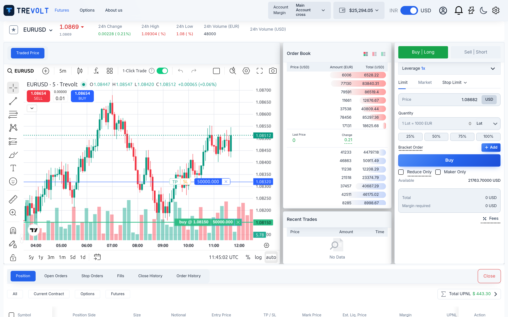
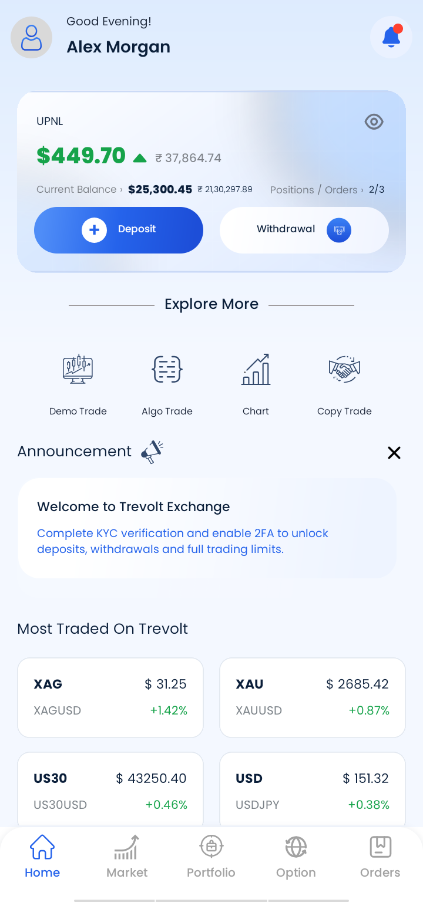

# Trevolt

A forex and CFD trading platform front end: a React web app, a React Native mobile app, and a small mock API that feeds both with demo data. You can open the terminal, watch prices tick, browse an options chain, check a wallet and P&L, and switch between light and dark themes.

It is a demo. Prices, accounts, orders and the blog content are all made up by the mock API, and nothing here places a real trade.



| Web, dark | Mobile, light | Mobile, dark |
|---|---|---|
|  |  |  |

More images are in `docs/screenshots`.

## What's in it

- **Trading terminal.** Candle chart, order book, recent trades, order ticket in lots, positions, open orders, fills and history. Ten instruments: EURUSD, GBPUSD, USDJPY, AUDUSD, USDCAD, USDCHF, XAUUSD, XAGUSD, USOIL and US30.
- **Options.** EURUSD, GBPUSD and XAUUSD chains with three expiries, bid/ask/mark, IV and greeks.
- **Account pages.** Dashboard, wallet, P&L analytics, sub-accounts, referral, API keys, history.
- **Copy trading, Listings and Earn** pages, plus a blog and a learn section.
- **Mobile app.** Home, Market, Portfolio, Option and Orders tabs, with the same data.
- Light and dark themes on both.

## Layout

| Folder | What it is |
|---|---|
| `web/` | React 19, Vite, Redux Toolkit, React Router, Axios, socket.io-client |
| `mobile/` | React Native 0.81 with TypeScript, Redux Toolkit, MMKV |
| `api/` | Node, Express and socket.io mock server on port 5000 |
| `docs/screenshots/` | Light and dark screenshots of web and mobile |

The client encrypts requests and responses with a shared key, so the mock server encrypts its replies the same way. The default key is `demo`.

## Running it

Start the mock API first.

```
cd api
npm install
npm start
```

Web app:

```
cd web
cp .env.example .env.dev
npm install
npm run dev
```

The chart on the terminal uses the TradingView Charting Library. It is licensed, so it is not in this repo. If you have access to it, copy `charting_library` and `datafeeds` into `web/public/`. Without it the chart area stays empty and the rest of the page works.

Mobile app (Android):

```
cd mobile
cp .env.example .env
npm install
npx react-native start
npx react-native run-android
```

On a real phone, run `adb reverse tcp:5000 tcp:5000` and `adb reverse tcp:8081 tcp:8081` so the app can reach the mock API and Metro. You also need a debug keystore at `mobile/android/app/debug.keystore`. The standard one works:

```
keytool -genkey -v -keystore mobile/android/app/debug.keystore -storepass android -alias androiddebugkey -keypass android -keyalg RSA -keysize 2048 -validity 10000 -dname "CN=Android Debug,O=Android,C=US"
```

Firebase config files (`google-services.json`, `GoogleService-Info.plist`) are not included, so push notifications and Google sign-in will not work until you add your own.

## Notes

- There is no real backend here. Login accepts any email and password, and placing an order does not match against anything.
- The `web` and `mobile` code expects the response shapes the mock API returns. If you point it at a different backend, those shapes will need to match.
- I only tested the Android build.
